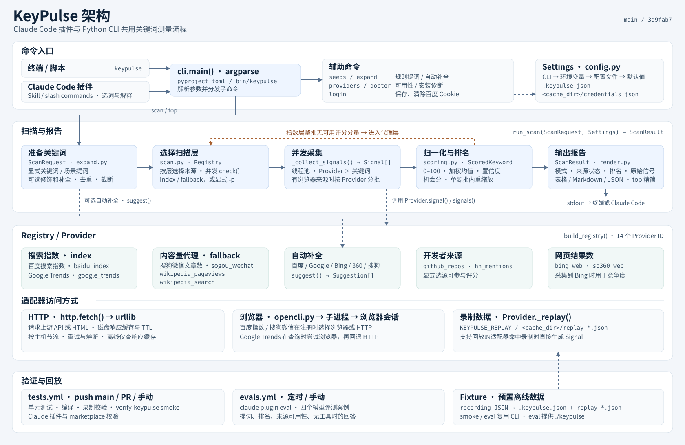

# KeyPulse

Keyword demand research for SEO and GEO. KeyPulse queries keyword indexes
across search engines — 百度指数, Google Trends, 微信/搜狗, Wikipedia and others
— from either a keyword list you give it or a product scenario it expands into
keywords, then ranks them so you can see which keywords carry the most weight.

It ships as a Claude Code plugin (a skill plus slash commands) and as a
standalone CLI. Everything is Python standard library — there is no install
step, no API key required for the default sources, and no data leaves your
machine except the queries themselves.

---

## What it does

```
$ keypulse scan -k "人工智能" "量子计算" "猫粮" -r CN
#     关键词   热度分   置信度   机会分   主要来源
1     人工智能  88.3  0.60  88.3  wikipedia_search:99, wikipedia_pageviews:79
2     量子计算  69.7  0.60  69.7  wikipedia_pageviews:71, wikipedia_search:68
3     猫粮     42.2  0.60  42.2  wikipedia_pageviews:48, wikipedia_search:35

数据来源: 指数不可用，改用内容量代理指标
注意: 指数来源不可用：排名基于内容量代理指标，不等于搜索指数。
```

With 百度指数 configured (or Google Trends reachable) the same command prints
`指数分` and `数据来源: 搜索引擎指数`. The column is renamed rather than
misleading you: proxy numbers are never labelled as an index.

- **`指数分` / `热度分` (score)** — 0–100 weighted demand, comparable within a scan.
- **`置信度` (confidence)** — share of requested sources that answered.
- **`机会分` (opportunity)** — demand discounted by competition.
- **数据来源** — whether the score came from a real index or from proxy metrics.

### Index first, proxies only as a fallback

The sources that actually measure search demand are **百度指数** and **Google
Trends**. They are also the two that need setup:

| Source | Needs | Notes |
|---|---|---|
| 百度指数 `baidu_index` | browser bridge, or a logged-in cookie | no browser: `keypulse login --baidu-cookie ...` |
| Google Trends `google_trends` | browser bridge, or a clean IP | no browser: `KEYPULSE_PROXY` for the 429 |

When either answers, the ranking is built from indexes. When neither is
reachable, KeyPulse falls back to volume proxies — Sogou's WeChat article count,
Wikipedia exact-phrase matches and pageviews — and the report says so
(`mode: fallback`, and the score column is renamed 热度分). It never presents a
proxy number as an index. If a whole tier fails mid-scan (a source that passed
its health check but then throttled every query), the scan drops that tier and
retries with the next one.

Autocomplete sources (百度/Google/Bing/360/搜狗下拉词) are used for **discovery**
— growing a keyword list — not for volume: every engine returns ~10 phrases
regardless of popularity.

GitHub and Hacker News are opt-in (`--include-audience`) because they skew every
ranking toward developer topics.

## Install

### As a Claude Code plugin

From a local checkout:

```bash
claude --plugin-dir /path/to/KeyPulse
```

Or from this repository as a marketplace:

```bash
/plugin marketplace add SwimmingLiu/KeyPulse
/plugin install keypulse --marketplace SwimmingLiu/KeyPulse
```

Then just describe what you want:

> 帮我给「面向程序员的 AI 笔记软件」找关键词，并按搜索指数排序

or use the slash commands:

```
/keypulse:keywords AI编程 AI笔记
/keypulse:providers CN
```

The skill checks which sources are reachable before it promises any numbers,
so you get an honest answer rather than a fabricated index.

### As a CLI

```bash
./bin/keypulse --help          # run straight from a checkout
export PATH="$PWD/bin:$PATH"   # or put it on PATH

# or install it (stdlib only, no runtime dependencies)
pip install -e .
keypulse --help
```

Requires Python 3.10+.

## CLI reference

```bash
keypulse scan       # query indexes for keywords and rank them
keypulse top        # leaders only
keypulse expand     # list autocomplete suggestions without measuring
keypulse seeds      # derive seed keywords from a scenario description
keypulse login      # store a Baidu Index cookie (enables 百度指数)
keypulse providers  # which sources are available right now
keypulse doctor     # self-check: is this install able to run scans?
```

### Enabling 百度指数

The simplest path is the browser bridge above — 百度指数 is then read from the
logged-in page with no configuration. Without a browser, the JSON API works
with a logged-in cookie:

```bash
# prints step-by-step instructions, or saves the cookie you paste
keypulse login --baidu-cookie "BDUSS=...; STOKEN=..."
keypulse providers -r CN     # verify it now shows ✓
```

The cookie is stored at `<cache>/credentials.json` with mode `0600`; the
`KEYPULSE_BAIDU_COOKIE` environment variable takes precedence when both are set.

Common flows:

```bash
# keywords from a scenario, grown with autocomplete, Chinese market
keypulse scan --scenario "面向跨境电商卖家的 AI 选品工具" --expand --region CN

# an explicit list, top 5 only, as Markdown for a chat reply
keypulse top --keywords "ai coding" "cursor ide" "copilot alternative" --region US --format md

# full raw data for your own analysis
keypulse scan -k "量子计算" "猫粮" -r CN --format json > report.json

# see what is working before you trust a number
keypulse providers -r CN
```

Useful flags: `--region {CN,US,GLOBAL}`, `--provider` (repeatable), `--expand`,
`--modifiers`, `--include-audience`, `--format {table,json,md}`, `--no-cache`,
`--offline`.

## Configuration

All optional, via environment variables:

| Variable | Default | Purpose |
|---|---|---|
| `KEYPULSE_BAIDU_COOKIE` | — | enables 百度指数 (paste the `BDUSS=...` cookie) |
| `KEYPULSE_CACHE_DIR` | `~/.cache/keypulse` | response cache location |
| `KEYPULSE_CACHE_TTL` | `21600` | cache lifetime in seconds |
| `KEYPULSE_TIMEOUT` | `15` | per-request timeout |
| `KEYPULSE_WORKERS` | `4` | parallel keyword queries |
| `KEYPULSE_HOST_INTERVAL` | `0.8` | minimum seconds between requests to one host |
| `KEYPULSE_PROXY` | — | route requests through a proxy, e.g. `http://127.0.0.1:7897` (the usual fix for Google Trends 429s) |
| `KEYPULSE_OFFLINE` | — | serve from cache only |
| `GITHUB_TOKEN` | — | raises the GitHub API rate limit |

Responses are cached on disk, so re-running a scan is nearly instant. Anti-bot
challenge pages are never cached, and a host that keeps failing is skipped for
the rest of the run rather than retried per keyword.

## How the score works

1. Each source's raw number is normalised to 0–100 with a transform suited to
   what it measures: identity for bounded indexes, log scale against a
   calibrated ceiling for counts, on-topic share for autocomplete.
2. Normalised values are averaged with per-source weights. Sources that fail
   drop out of the blend — so a blocked source lowers *confidence*, not the
   score.
3. `opportunity` discounts demand by competition (Bing result counts, WeChat
   article volume), which is what identifies keywords worth targeting.

The full algorithm and its calibration notes are in
[`src/keypulse/scoring.py`](src/keypulse/scoring.py).



## Development

```bash
python3 -m unittest discover -s tests -v    # 89 tests, no network required
python evals/fixtures/verify_recording.py   # eval fixtures are usable
claude plugin validate .                    # manifest + component checks
```

Layout:

```
.claude-plugin/   plugin + marketplace manifests
bin/keypulse      CLI entry point (stdlib only)
src/keypulse/     implementation
  providers/      one module per source
  expand.py       scenario → seeds, seed → candidates
  scoring.py      normalisation, weighting, ranking
  scan.py         orchestration
skills/keypulse/  the agent-facing skill + playbook
commands/         /keypulse:keywords, /keypulse:providers
tests/            offline unit tests
evals/            plugin eval suite (cases, graders, replay recordings)
.github/workflows unit tests + evals in CI
```

## Browser bridge (opencli)

Google Trends and 百度指数 gate their APIs by IP and session. From a real
browser they work; from a script they return 429 / 异常访问. KeyPulse therefore
uses [opencli](https://www.npmjs.com/package/opencli)'s browser bridge when it is available:

- **Google Trends** is fetched from inside a browser tab — the same endpoint
  that answers 429 to `urllib` answers 200 from the page.
- **百度指数** is read by driving the search box on `index.baidu.com` and
  reading the 搜索指数概览 table (the JSON API is blocked even in-browser).
  Words Baidu does not index are reported as `未收录` with a zero — that is
  Baidu's own answer, so it counts as data rather than a lookup failure.
- **微信文章数** is read from Sogou's WeChat vertical, which serves an
  anti-spider page to plain HTTP but renders normally in a browser.

Nothing is required to use the bridge: if `opencli` is installed and its
browser extension is connected (`opencli doctor`), it is used automatically.
Otherwise KeyPulse falls back to plain HTTP and reports the source as
unavailable rather than inventing a number. Disable it with
`KEYPULSE_BROWSER=off`.

| Transport | Needs | Typical sources |
|---|---|---|
| browser bridge | `opencli` + connected browser | 百度指数, Google Trends, 微信文章数 |
| plain HTTP | network access (proxy for Trends) | autocomplete, Wikipedia, Bing, GitHub |

## Verifying a change

`.claude/skills/verify-keypulse/` is a project-local verification skill: it
drives the real CLI the way a user does and captures command, exit code and
output as evidence. Start with its feature map
(`features/README.md`), then run a recipe.

```bash
./bin/keypulse doctor                        # is this install usable?
.claude/skills/verify-keypulse/scripts/smoke.sh   # prove the whole skill works
```

The smoke script runs doctor, three feature recipes and a deliberate failure
path, then checks the evidence survived cleanup. It runs in CI on every push.

Recipes are isolated: each gets its own scratch directory and cache, seeded with
the replay recording, so a verification run never depends on Baidu or Google
answering and never touches your `~/.cache/keypulse`.

## Evaluation

The plugin ships an eval suite (`claude plugin eval .`) with four cases:

| Case | What it checks |
|---|---|
| `scenario-seeds` | a scenario becomes whole keyword phrases, not n-gram fragments |
| `scan-ranks` | the agent runs the CLI and reports the higher-weight keyword |
| `providers-honesty` | unavailable sources are reported as unavailable, never as zero |
| `skill-only` | the answer defers to the CLI and asserts no invented index number |

The eval sandbox has no network, so cases replay recorded provider values
(`evals/*/recording.json`) through the same offline cache the CLI uses. The
recording is genuine data captured once with
`python evals/fixtures/record_cache.py --keywords 人工智能 量子计算 猫粮`.

Each case's `fixture.sh` also drops a `./keypulse` wrapper into the sandbox
workspace that points at this checkout's `bin/keypulse`. The agent's Bash tool
does **not** get `$CLAUDE_PLUGIN_ROOT` in the eval sandbox, so a prompt that
told it to run `"$CLAUDE_PLUGIN_ROOT/bin/keypulse"` would expand to
`/bin/keypulse` and fail; `./keypulse` works the same on every platform.

The `skill-only` case answers a question the model could otherwise guess at:
without the plugin a run may answer from general knowledge; the graders require
the `- 我会：` line to name KeyPulse and the `- 我不会：` line to refuse
fabrication (both regexes, scored across the trace so a correct answer still
counts after further exploration). All four cases score **1.00** with the
plugin.

```bash
# one case, offline, cheap
claude plugin eval . --trust-plugin --no-publish --scaffold \
  --case scan-ranks --runs 1 --ablation none \
  --allow-tools Bash Read Grep Glob Skill --threshold 0.8 \
  --judge-model claude-haiku-4-5

# verify every case has a usable recording (used in CI)
python evals/fixtures/verify_recording.py
```

CI runs unit tests and manifest validation on every push
(`.github/workflows/tests.yml`) and the eval suite on a schedule or on demand
(`.github/workflows/evals.yml`). The eval job runs against any
Anthropic-protocol upstream: set `EVAL_ANTHROPIC_KEY` to that upstream's key
and, if it is not the default `https://betteryou.top`, edit `EVAL_BASE_URL` in
the workflow. If the secret is unset the job **fails** with the command to add
it, so a green check always means the suite really ran:

```bash
gh secret set EVAL_ANTHROPIC_KEY -R SwimmingLiu/KeyPulse
gh workflow run evals.yml
```

To run the same suite locally against that upstream, mirror what the workflow
sets — the point is that no local gateway is involved:

```bash
export ANTHROPIC_BASE_URL=https://betteryou.top \
       ANTHROPIC_AUTH_TOKEN=<key> \
       ANTHROPIC_DEFAULT_HAIKU_MODEL=deepseek-v4-1-flash-1017 \
       ANTHROPIC_DEFAULT_SONNET_MODEL=deepseek-v4-1-flash-1017 \
       ANTHROPIC_DEFAULT_OPUS_MODEL=deepseek-v4-1-flash-1017
unset ANTHROPIC_API_KEY
```

## Notes on the data sources

- 微信指数 has no public API (it lives in a mini-program); KeyPulse uses Sogou's
  WeChat article count as the closest public proxy. Sogou throttles by IP — if
  it shows "触发反爬验证", the scan continues without it.
- 百度指数 requires a logged-in cookie. KeyPulse implements the published `ptbk`
  decryption scheme and reports a missing cookie as *unavailable*, not as zero.
- Google Trends rate-limits by IP. Expect 429 without a proxy on shared
  networks.
- Scraped counts (Bing/360 result totals) are estimates published by the
  engines and drift; they inform competition, not demand.

### Prior art

The Baidu Index `ptbk` decryption scheme follows the approach used by
[Ofnoname/baidu-index-spider](https://github.com/Ofnoname/baidu-index-spider)
and the many crawlers derived from it; the WeChat proxy uses the same article
counting that
[yunle8/WechatIndexCrawl](https://github.com/yunle8/WechatIndexCrawl) relies on
for the (now-closed) mini-program endpoint. KeyPulse reimplements both with no
third-party dependencies rather than vendoring those projects.

## License

GPL-3.0 — see [LICENSE](LICENSE).
